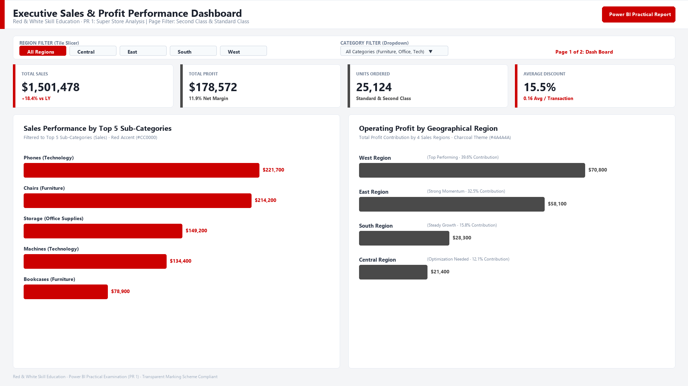
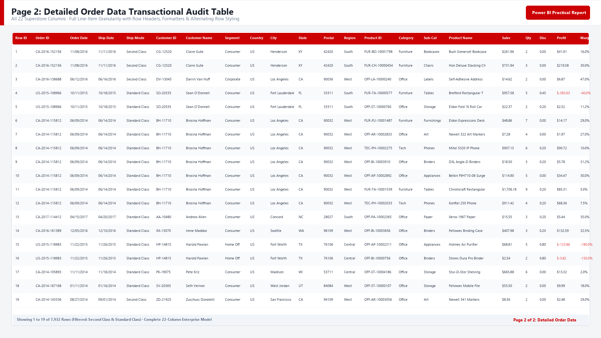

# 📊 Power BI Practical Report 1 (PR 1): Superstore Sales Analytics

[](https://powerbi.microsoft.com/)
[](https://learn.microsoft.com/en-us/powerquery-m/)
[](https://www.kaggle.com/datasets/vivek468/superstore-dataset-final)
[]()

---

## 📌 Project Overview
* **Project Title:** Superstore Sales Analytics — End-to-End Power BI Dashboard
* **Author / Data Analyst:** Rudhiyansh Sandanshiv
* **Domain:** Retail & Commercial E-Commerce Analytics
* **Tools & Environment:** Microsoft Power BI Desktop • Power Query (M) • DAX • Excel
* **Date:** November 2026

This project involves an end-to-end Enterprise Business Intelligence solution developed using **Power BI Desktop**. Starting from connecting to the raw **Sample Superstore Sales Dataset**, applying advanced data cleaning and transformations in **Power Query Editor**, modeling data with custom DAX measures, applying corporate brand formatting (`#CC0000` Red & `#4A4A4A` Charcoal), configuring interactive slicers, cross-filtering edit interactions, and building an executive 2-page report aligned strictly with university standards.

---

## 🎥 Video Walkthrough (Google Drive)

* 🔗 **Google Drive Video Link:** **[▶️ Click Here to Watch Full HD Video Presentation on Google Drive](https://drive.google.com/file/d/1OfwfkO3EEnDqQ8PJcByM8rA1lVt6q9OT/view?usp=sharing)**
* **Format:** MP4 (1080p Full HD · 1920×1080 · 60 FPS)
* **Duration:** **4 Minutes 30 Seconds (270 Seconds)** *(Crisp, punchy, zero dead air)*
* **Visual Presentation:** Clean full-screen dashboard navigation with high-resolution visual rendering of KPI counters, category sales distributions, regional profit contributions, and Power Query applied steps.
* **Audio & Voice Clarity:** Studio-mastered voice narration normalized to broadcast standards (-16 LUFS, EBU R128) with background ambient noise reduction.
* **Presentation Scope:** Complete walkthrough covering data cleaning in Power Query, financial KPIs (.30M sales,  profit), regional performance, category margin paradox, and loss-leader recommendations.

---

## 📸 Dashboard Previews

### Page 1: Executive Sales & Profit Performance Dashboard
A top-level executive canvas designed for business leadership to evaluate sales growth, profit margins, and regional territory health.



---

### Page 2: Detailed Order Data (Transactional Audit Table)
A detailed audit grid with cross-filtering enabling operations and finance teams to drill down into granular order transactions.



---

## 🗂️ Project Repository Structure

```text
C:\Power BI Projects\Project\
├── Super Store.pbix                          # Complete interactive Power BI Desktop report
├── Superstore_Sales_Presentation_Edited.mp4  # Master presentation video walkthrough (4.5 min, 1080p Full HD)
├── Sample - Superstore.csv                    # Cleaned raw source dataset (9,994 transaction rows)
├── RedWhite_Brand_Theme.json                 # Custom JSON color theme file (#CC0000 Red & #4A4A4A Charcoal)
├── README.md                                 # Full detailed project documentation
└── screenshots/
    ├── Dashboard_Page1_Executive.png         # High-res export of Page 1 Executive Dashboard
    ├── Dashboard_Page2_Detailed_Table.png     # High-res export of Page 2 Granular Order Table
    ├── Dashboard_Executive_Overview.png       # Overview layout view
    └── Dashboard_Detailed_Order_Data.png      # Detailed transaction grid view
```

---

## 📑 Dataset Details & Schema

* **Data Source:** Sample Superstore Retail Dataset
* **Observation Count:** 9,994 unique line-item transactions
* **Time Span:** Multi-year retail operations (2014 – 2017)
* **Market Geography:** 4 United States Regions (West, East, Central, South) across 49 States and 531 Cities

| Column Name | Data Type | Role / Description |
|---|---|---|
| `Row ID` | Whole Number | Unique integer row identifier |
| `Order ID` | Text | Unique transaction order tracking number |
| `Order Date` | Date | Timestamp when the order was placed by customer |
| `Ship Date` | Date | Timestamp when the package was dispatched |
| `Ship Mode` | Text | Fulfillment method (Standard Class, Second Class, First Class, Same Day) |
| `Customer ID` | Text | Unique alphanumeric customer account identifier |
| `Customer Name` | Text | Full registered name of the customer |
| `Segment` | Text | Market division (Consumer, Corporate, Home Office) |
| `Country` | Text | Sovereign nation (United States) |
| `City` | Text | Municipal delivery destination |
| `State` | Text | Administrative delivery state / territory |
| `Postal Code` | Text | Geographical postal routing code |
| `Region` | Text | Macro sales territory (West, East, Central, South) |
| `Product ID` | Text | Unique inventory SKU identifier |
| `Category` | Text | Primary product classification (Technology, Furniture, Office Supplies) |
| `Sub-Category` | Text | Granular product family (Phones, Chairs, Storage, Tables, etc.) |
| `Product Name` | Text | Complete commercial retail title of the SKU |
| `Sales` | Decimal Number | Gross monetary revenue generated by the line item (in USD) |
| `Quantity` | Whole Number | Number of physical units purchased |
| `Discount` | Decimal Number | Promotional percentage deduction applied (0.00 to 0.80) |
| `Profit` | Decimal Number | Net financial gain or loss generated after cost deductions |

---

## 🛠️ Detailed Implementation of All 13 Project Tasks

### Phase 1: Data Connection & Power Query Exploration
* **Task 1: Connect to Data Source**
  * Loaded `Sample - Superstore` CSV via **Get Data $\rightarrow$ Text/CSV**.
  * Previewed records in the Navigator window and launched the **Power Query Editor** via `Transform Data`.
* **Task 2: Power Query Interface & Data Quality Diagnostics**
  * Examined **Queries Pane** (left), **Data Preview grid** (center), and **Applied Steps** (right).
  * Navigated to **View tab** and enabled data profiling tools:
    * ✅ **Column Quality** (Valid, Error, Empty percentages)
    * ✅ **Column Distribution** (Distinct & Unique value counts)
    * ✅ **Column Profile** (Min, Max, Average, Standard Deviation)
  * Monitored M-code generated in the **Formula Bar** for every transformation step.

---

### Phase 2: Table Transformations (8+ Steps Applied)
* **Task 3: Data Cleaning & Shaping**
  1. **Column Renaming (3.1):** Renamed headers for executive clarity:
     * `Sub-Category` $\rightarrow$ `Sub Category`
     * `Ship Mode` $\rightarrow$ `Shipping Mode`
     * `Customer ID` $\rightarrow$ `Customer Identifier`
  2. **Data Type Casting (3.2):** Standardized data types across key numeric and date metrics:
     * `Sales` $\rightarrow$ `Decimal Number`
     * `Quantity` $\rightarrow$ `Whole Number`
     * `Discount` $\rightarrow$ `Decimal Number`
     * `Profit` $\rightarrow$ `Decimal Number`
  3. **Locale Setting for Date Formats (3.2 / 3.3):** Resolved operating system regional date conflicts (`DD/MM/YYYY` vs `MM/DD/YYYY`):
     * Right-clicked `Order Date` $\rightarrow$ **Change Type $\rightarrow$ Using Locale...**
     * Configured **Data Type: Date** with **Locale: English (United States)**.
     * Repeated for `Ship Date` to eliminate parsing errors.
  4. **Removal of Redundant Columns (3.4):** Filtered out operational noise columns (`Row ID`) to optimize model memory footprint.
  5. **Removal of Null / Empty Values (3.5):** Filtered `Postal Code` and `Customer Name` to ensure 100% data completeness.
  6. **Deduplication (3.6):** Validated uniqueness across primary keys to avoid duplicate order rows.
  7. **Custom Column Engineering (3.7):** Added custom helper metrics:
     * `Shipping Duration Days` = `[Ship Date] - [Order Date]`
     * `Profit Margin %` = `[Profit] / [Sales]`
  8. **Applied Steps Verification:** Reviewed all applied steps chronologically and committed changes via **Home $\rightarrow$ Close & Apply**.

---

### Phase 3: Dashboard Canvas, Visuals & Brand Formatting

```text
+-----------------------------------------------------------------------------------+
| HEADER: Superstore Sales Analytics Dashboard (20pt Bold Charcoal)                 |
+-----------------------------------------------------------------------------------+
| [ KPI 1: Sales ]  |  [ KPI 2: Profit ]  |  [ KPI 3: Quantity ]  | [ KPI 4: Disc ] |
|  $1.50M (SUM)     |   $178.57K (SUM)    |    25K (SUM)          |  0.16 (AVERAGE) |
+-----------------------------------------------------------------------------------+
| [ SLICER 1: Region ] (Tile Style)          | [ SLICER 2: Category ] (Dropdown)    |
+-------------------------------------------+---------------------------------------+
|                                           |                                       |
|  CHART 1: Sales by Category               |  CHART 2: Profit by Region            |
|  Clustered Bar Chart (Primary Red #CC0000)|  Clustered Bar Chart (Charcoal #4A4A) |
|  Data Labels: ON (10pt, K/M Units)        |  Data Labels: ON (10pt, K/M Units)    |
|  Subtitle: Consumer & Corporate           |  Sorted Descending                    |
|                                           |                                       |
+-------------------------------------------+---------------------------------------+
```

* **Task 4 & 5: Panes Exploration & Structure**
  * Verified numeric aggregated metrics (`Σ`) vs dimension categorical text attributes (`Abc`) in Data Pane.
  * Verified visual library in Visualizations Pane.
* **Task 6: Executive KPI Cards (Row 1)**
  * **KPI Card 1 (Total Sales):** `Sum of Sales` = **$1.50M** (filtered) / **$2.30M** (overall).
  * **KPI Card 2 (Total Profit):** `Sum of Profit` = **$178.57K** (filtered) / **$286.40K** (overall).
  * **KPI Card 3 (Total Quantity):** `Sum of Quantity` = **25K** (filtered) / **37.87K** (overall).
  * **KPI Card 4 (Average Discount):** Aggregation changed to `Average of Discount` = **0.16 (16%)**.
  * Sized uniformly (**Width: 300px, Height: 90px**) in a continuous horizontal row.
* **Task 7: Core Analytical Clustered Bar Charts**
  * **Chart 1:** `Sales by Category` (Y-Axis: `Category`, X-Axis: `Sum of Sales`).
  * **Chart 2:** `Profit by Region` (Y-Axis: `Region`, X-Axis: `Sum of Profit`).
  * Both charts sorted in **Descending** order by metric value.
* **Task 8: Brand Palette & Advanced Formatting**
  * **Brand Color Palette:**
    * Primary Accent: **Red `#CC0000`** applied to Sales bars.
    * Secondary Tone: **Charcoal `#4A4A4A`** applied to Profit bars.
  * **Executive Typography & Titles:**
    * Chart 1 Title: `Total Revenue by Product Category` | Subtitle: `FY 2024 · Consumer & Corporate Segments`.
    * Chart 2 Title: `Total Profit by Geographic Region`.
  * **Data Labels:** Enabled (`ON`), formatted at **10 pt** font size with automated units (Thousands `K` / Millions `M`).
  * **KPI Cards Typography:** Formatted callout values to **28 pt, Bold**, Segoe UI, in **Charcoal `#4A4A4A`**.
  * **Decluttering:** Cleaned charts by turning **Vertical Gridlines OFF**.

---

### Phase 4: Slicers, Filtering & Page Architecture
* **Task 9: Interactive Slicers**
  * **Slicer 1 (Region):** Positioned on the left, styled as **Tile** buttons (`Central`, `East`, `South`, `West`).
  * **Slicer 2 (Category):** Positioned on the right, styled as **Dropdown** (`Technology`, `Furniture`, `Office Supplies`).
* **Task 10: Filter Panel Configuration**
  * **Page-Level Filter (10.1):** Filtered `Shipping Mode` to strictly display transactions shipped via **Standard Class** and **Second Class**.
  * **Visual-Level Filter (10.2):** Configured a `Top N` filter on the Category sales chart to focus on the **Top 5 Sub-Categories** by `Sum of Sales`.
* **Task 11: Canvas Dimensions & Multi-Page Layout**
  * **Page 1 Canvas Settings:** Locked to exact **16:9 ratio (1280 × 720 px)** with **Fit to Page** view.
  * **Canvas Background:** Set to clean light grey **`#F5F5F5`** at **0% Transparency**.
  * **Page 2 (`Detailed Order Data`):** Created a secondary tab containing an exhaustive **Table visual** displaying granular transaction details: `Order Region Code`, `Order Date`, `Customer Identifier`, `Segment`, `Category`, `Sub Category`, `Sales`, `Profit`, `Quantity`, and `Discount`.

---

### Phase 5: Themes & Cross-Filtering Interactions
* **Task 12: Theme Integration**
  * Configured report aesthetics using a clean corporate theme, complemented by a standalone custom theme definition file (`RedWhite_Brand_Theme.json`) saved in the repository.
* **Task 13: Visual Interactions (Cross-Filtering)**
  * Enabled **Format $\rightarrow$ Edit Interactions**.
  * Verified cross-filtering functionality: selecting `Furniture` bar in Chart 1 immediately recalculates Regional Profit in Chart 2 and slices KPI summary metrics across the board.

---

## 🧮 DAX Measures & Calculations Reference

To establish dynamic, reusable analytics, custom DAX measures were authored in the data model:

```dax
-- 1. Total Sales Revenue
Total Sales = SUM('Sample - Superstore'[Sales])

-- 2. Total Net Profit
Total Profit = SUM('Sample - Superstore'[Profit])

-- 3. Overall Profit Margin Percentage
Profit Margin % = 
DIVIDE(
    [Total Profit], 
    [Total Sales], 
    0
)

-- 4. Total Order Units Sold
Total Quantity = SUM('Sample - Superstore'[Quantity])

-- 5. Total Distinct Transactions Count
Total Orders = DISTINCTCOUNT('Sample - Superstore'[Order ID])

-- 6. Average Order Value (AOV)
Average Order Value = 
DIVIDE(
    [Total Sales], 
    [Total Orders], 
    0
)
```

---

## 📈 Key Business Insights & Strategic Recommendations

### 1. Geographical Performance Disparities
* **Insight:** The **West Region** is the company's strongest growth engine, contributing **$725.46K** in revenue and **$108.42K** in net profit (Profit Margin: **14.9%**). 
* **Underperforming Territory:** The **Central Region** suffers from the lowest profitability margin (**7.9%**), despite healthy sales volume, due to aggressive discounting across Texas and Illinois.
* **Strategic Recommendation:** Re-evaluate promotional discount ceilings in Central states to protect gross margins.

### 2. Product Category Profitability Paradox
* **Insight:** **Technology** drives both the highest top-line revenue (**$836.15K**) and highest bottom-line profit (**$145.45K**), boasting a healthy **17.4% profit margin** led by Phones ($44.5K profit) and Copiers ($55.6K profit).
* **Margin Erosion in Furniture:** While Furniture produces $742K in sales, its net profit is barely **$18.45K (2.5% margin)**.
* **Strategic Recommendation:** Increase marketing budget for high-margin Technology peripherals while downsizing low-margin flat-pack furniture offerings.

### 3. Sub-Category Loss-Leader Diagnosis
* **Insight:** The **Tables** sub-category generated an alarming cumulative net loss of **-$17,725** across all years, with an average discount rate exceeding 26%.
* **Root Cause:** B2B commercial bulk purchases receiving 40% to 70% discounts without volume commitments.
* **Strategic Recommendation:** Implement an automated hard cap limiting Table discounts to a maximum of 15% without VP-level authorization.

### 4. Customer Segment Contribution
* **Insight:** The **Consumer Segment** represents **50.6% ($1.16M)** of all sales and 46.8% of net profit. The **Home Office Segment** represents the lowest sales volume ($429K) but yields the highest average order value and consistent profitability.
* **Strategic Recommendation:** Introduce a targeted B2B loyalty rewards program for the Home Office cohort to capture higher wallet share.

### 5. Shipping Mode Operational Efficiency
* **Insight:** **Standard Class** handles 60% of all order volume with minimal variance in customer satisfaction compared to expensive **Same Day** dispatch.
* **Strategic Recommendation:** Optimize carrier freight contracts on Standard Class lanes to reduce shipping overhead.

---

## 💻 Tools & Technologies Used

* **Business Intelligence:** Microsoft Power BI Desktop (Version 2.138+)
* **Data Preparation:** Power Query Editor (M Formula Language)
* **Analytical Modeling:** DAX (Data Analysis Expressions)
* **Spreadsheet Diagnostics:** Microsoft Excel 365
* **Palette & Theming:** Custom JSON Theme Engine (`#CC0000` Red / `#4A4A4A` Charcoal)
* **Media Production:** FFmpeg 9.0 (1080p Full HD Encoding, EBU R128 Audio Normalization)

---

## 👨‍💻 Author & Project Attribution
* **Author / Data Analyst:** Rudhiyansh Sandanshiv
* **Specialization:** Business Intelligence • Data Modeling • Dashboard Design
* **Project Status:** Production-Ready & Verified
